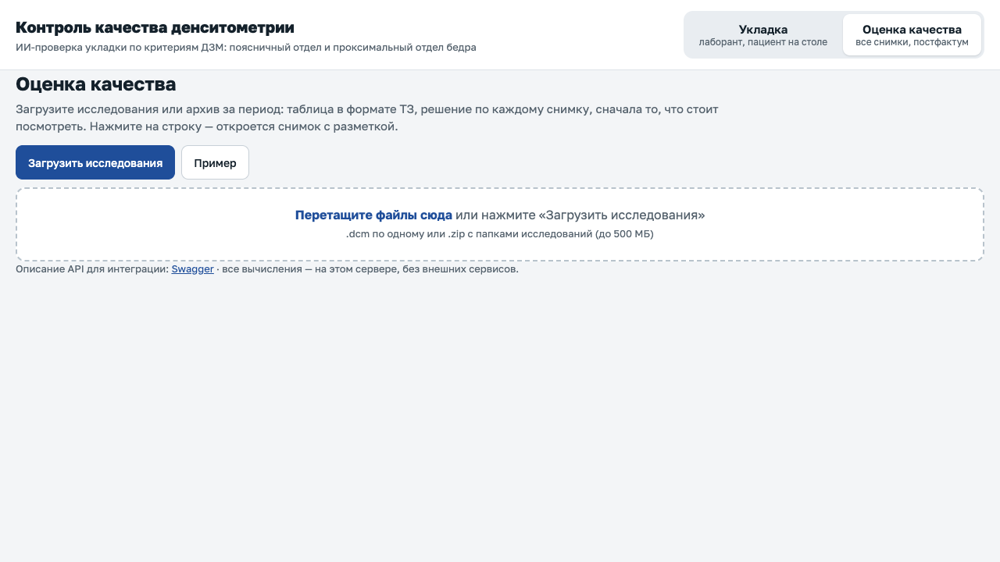
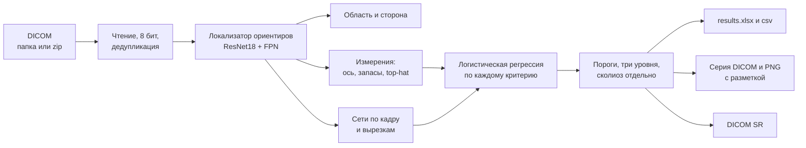
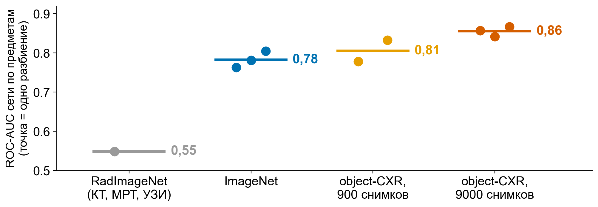
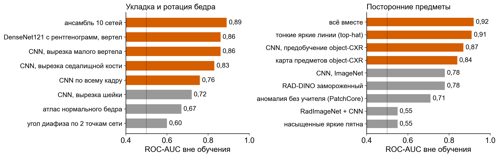
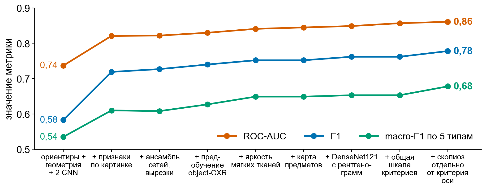
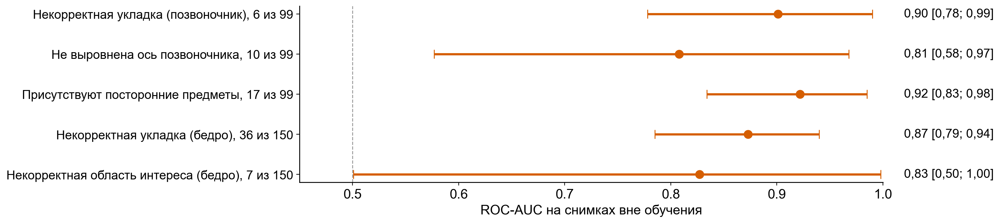

# DXA-QC: контроль качества денситометрии

Сервис принимает DICOM-исследования денситометрии (DXA), определяет анатомическую область и находит технические ошибки
укладки. На выходе таблица результатов, снимок с разметкой нарушения и заключение в формате DICOM SR.

Проект команды «Пироговский Университет» на хакатоне «Лидеры цифровой трансформации 2026», задача № 4 Центра диагностики
и телемедицины Департамента здравоохранения Москвы.

**Результат:** второе место в финале задачи. Сервис работает локально, без обращения к внешним системам.



*Страница сервиса с двумя режимами: «Укладка» для лаборанта и «Оценка качества» для врача. Снимки постановщика здесь не показаны.*

## Задача

При денситометрии ошибка укладки искажает измерение плотности кости, а заметить её можно уже на столе, пока пациент
не ушёл. Сервис отвечает на три вопроса: какая область на снимке, годен ли снимок и какие нарушения найдены.

| Область | Нарушение | Что измеряется |
|---|---|---|
| Поясничный отдел позвоночника | некорректная укладка | полоса таза у нижнего края кадра, видимость Th12 и гребней |
| Поясничный отдел позвоночника | не выровнена ось | наклон оси по массе кости, наклон самой ровной трети |
| Поясничный отдел позвоночника | посторонние предметы | тонкие яркие линии вне столба, карта предметов, свёрточные сети |
| Проксимальный отдел бедра | некорректная укладка | ось диафиза, ансамбль сетей по кадру и вырезкам вокруг ориентиров |
| Проксимальный отдел бедра | некорректная область интереса | запасы от ориентиров до краёв кадра в сантиметрах |

Сколиоз, перелом и эндопротез нарушением укладки не считаются. Плотность кости сервис не рассчитывает.

## Как работает



Главная мысль решения: каждый вердикт подкреплён измерением. Лаборант видит угол оси, запас в сантиметрах или рамку
предмета, а врач получает отметку «проверить» для снимков у порога.

| Компонент | Что делает |
|---|---|
| Локализатор ориентиров | 8 ориентиров позвоночника и 11 ориентиров бедра; медиана ошибки 2–6 мм при расхождении двух разметчиков 2,9 мм |
| Измерения по снимку | ось позвоночника и диафиза, запасы до краёв, полоса таза, яркость мягких тканей, морфологический top-hat |
| 3 сети по предметам | предобучены на 9000 рентгенограмм грудной клетки object-CXR, а не на ImageNet |
| 10 сетей по укладке бедра | ResNet18, EfficientNet-B0, DenseNet121 с весами рентгенограмм; кадр целиком и вырезки у вертела и седалищной кости |
| Логистическая регрессия | 2–4 признака на критерий: на редких классах сложная модель не обобщается |
| Сколиоз | угол искривления по центрам тел L1–L5, при деформации критерий оси не бракует снимок |
| FleXray | необязательный модуль: второй голос за область и контуры позвонков |

Перенос с рентгенограмм грудной клетки оказался самым сильным приёмом: на посторонних предметах ROC-AUC вырос
с 0,78 (ImageNet) до 0,86. Инициализация RadImageNet на этом критерии дала 0,55.



Что пробовали и что вошло в решение (оранжевое вошло):



Вклад шагов в итоговые метрики:



## Метрики

249 снимков вне обучения, кросс-валидация по исследованиям, 95 % ДИ получены бутстрепом по исследованиям.
Полный отчёт в [docs/metrics.md](docs/metrics.md).

| Есть ли нарушение на снимке | Значение [95 % ДИ] |
|---|---|
| ROC-AUC | 0,861 [0,806; 0,913] |
| PR-AUC | 0,738 [0,623; 0,858] |
| F1 | 0,778 [0,699; 0,846] |
| Accuracy | 0,871 [0,835; 0,908] |
| Balanced accuracy | 0,844 [0,797; 0,892] |
| Чувствительность | 0,778 [0,690; 0,869] |
| Специфичность | 0,910 [0,869; 0,948] |

| Тип нарушения | С нарушением | ROC-AUC [95 % ДИ] | F1 |
|---|---|---|---|
| Некорректная укладка, позвоночник | 6 из 99 | 0,901 [0,778; 0,990] | 0,667 |
| Не выровнена ось позвоночника | 10 из 99 | 0,808 [0,577; 0,968] | 0,526 |
| Посторонние предметы | 17 из 99 | 0,922 [0,834; 0,985] | 0,778 |
| Некорректная укладка, бедро | 36 из 150 | 0,873 [0,785; 0,940] | 0,753 |
| Некорректная область интереса, бедро | 7 из 150 | 0,827 [0,501; 0,998] | 0,667 |

Macro-F1 по пяти типам равен 0,678. Обработано 499 файлов из 499. Исследование из трёх снимков занимает 7,7 с
в контейнере amd64 без сети и 8,6 с на сервере с 2 ядрами в экономном режиме. Контейнер запускается ещё около 25 с.



### Что важно знать про эти цифры

- **Это оценка команды, а не закрытый тест.** Финальную проверку на закрытых данных проводил организатор на своей стороне.
- **Данных мало.** В наборе 100 исследований и 252 уникальных снимка. Для трёх критериев снимков с нарушением всего 6–10,
  поэтому интервалы широкие: у области интереса бедра нижняя граница 0,50, то есть уровень случайного угадывания.
- **Цифры немного оптимистичны.** Пороги выбраны по максимуму F1 на тех же снимках вне обучения, на которых затем посчитаны метрики.
- **Пропуски есть.** При чувствительности 0,778 примерно каждое пятое нарушение не будет найдено. Для этого есть режим
  `--mode sensitive` с чувствительностью не ниже 0,9 по критерию ценой большего числа пересъёмок.
- **Один аппарат.** Обучение и проверка выполнены на снимках GE Lunar Prodigy Advance. На двух открытых наборах других
  аппаратов область определяется верно, но критерии без дообучения не переносятся: на первом наборе «посторонние предметы»
  срабатывали на всех снимках.
- **Искажения снимка влияют на решения.** На искажённых копиях 40 снимков обработка и область верны в 100 % случаев,
  а решения по критериям совпадают с исходными в 75–100 % случаев.

## Запуск

Для запуска в контейнере нужен Docker 24+, для запуска без контейнера Python 3.12. Весов в репозитории нет, поэтому
без них сервис пишет об этом в журнал, отвечает заглушкой «нарушений нет», а `/health` показывает `weights_loaded: false`.
Не используйте этот режим для оценки снимков.

```bash
python -m venv .venv && source .venv/bin/activate
pip install -r requirements.txt
PYTHONPATH=src pytest -q
```

Тесты с настоящими снимками и весами пропускаются, если их нет.

Веса можно обучить на своих данных по [docs/TRAINING.md](docs/TRAINING.md). Когда они лежат в `weights/`:

```bash
./run.sh build                          # сборка образа
./run.sh batch in out --overlays --sr   # пакетная обработка папки или zip, контейнер работает без сети
./run.sh serve                          # веб-страница http://localhost:8000 и Swagger /docs
```

| Выход | Что это |
|---|---|
| `results.xlsx`, `results.csv` | одна строка на файл: область, класс, типы нарушений, вероятность, статус, время |
| `series/*_SC.dcm`, `overlays/*.png` | снимок с ориентирами, осью, рамками предметов и вердиктом |
| `sr/*_SR.dcm` | заключение в формате DICOM SR |
| `additional_series.zip` | дополнительные серии одним архивом |

Основные адреса HTTP-сервиса: `POST /api/analyze`, `GET /api/runs/{run_id}/results.xlsx`, `GET /health`, `GET /docs`.

## Документация

| Документ | Содержание |
|---|---|
| [docs/ARCHITECTURE.md](docs/ARCHITECTURE.md) | архитектура и формат результатов |
| [docs/metrics.md](docs/metrics.md) | полный отчёт по метрикам |
| [docs/TRAINING.md](docs/TRAINING.md) | обучение и дообучение |
| [docs/DEPLOY.md](docs/DEPLOY.md) | контейнер, сервер, обратный прокси, машина без интернета |
| [docs/USER_GUIDE.md](docs/USER_GUIDE.md) | руководство пользователя |
| [docs/LABELING_PROTOCOL.md](docs/LABELING_PROTOCOL.md) | протокол разметки ориентиров |

## Структура

```text
src/dxaqc/        сервис: чтение DICOM, ориентиры, критерии, сети, вердикт, DICOM SR, API и веб-страница
scripts/          обучение, отчёт по метрикам, проверка порогов и устойчивости
experiments/      скрипты экспериментов, в том числе отклонённых
tools/labeler/    веб-инструмент разметки ориентиров
tests/            автотесты
docs/             документация и графики
run.sh            сборка и запуск контейнера
```

## Стек

Python 3.12, PyTorch, torchvision, timm, OpenCV, scikit-learn, pydicom, FastAPI, Docker. Декодеры сжатых DICOM:
pylibjpeg, pylibjpeg-openjpeg, python-gdcm. Страница сервиса написана на HTML, CSS и JavaScript без библиотек.

## Команда

Команда «Пироговский Университет», 3 человека.

| Участник | Роль |
|---|---|
| Александр Гаданов | капитан; разметка анатомических ориентиров, организация работы команды |
| **Андрей Семенов** | детский ортопед, к.м.н.; модель, сервис, клиническая экспертиза, протокол разметки |
| Саак Серобян | врач; клиническая экспертиза, подготовка материалов |

Код, эксперименты и документация готовились с ИИ-ассистентом (Claude Code) под контролем врача-ортопеда команды.
В работе самого сервиса внешние ИИ-системы не участвуют.

## Данные, веса и лицензия

Снимки, разметка и материалы постановщика в репозиторий не входят. Веса обучены на этих снимках и тоже не публикуются.
Онлайн-прототип на время конкурса работал на отдельном сервере, сейчас он отключён.

Это исследовательский проект. Он не является медицинским изделием и не предназначен для самостоятельного клинического
применения без процедур, установленных законодательством.

Код распространяется по лицензии [MIT](LICENSE). Часть сторонних данных и весов разрешена только для некоммерческого
использования: при коммерческом внедрении модули с ними нужно заменить. Подробности в [THIRD_PARTY.md](THIRD_PARTY.md).
